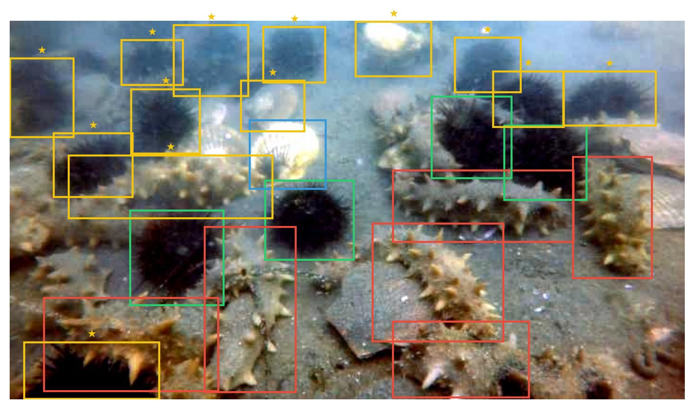

<div align="center">

# Cross-Domain Robustness of CNN vs Transformer Detectors for Underwater Object Detection

**Buthaina Almulla · Abdulla Alshehhi · Shamma Yaqoob**

Mohamed bin Zayed University of Artificial Intelligence (MBZUAI), Abu Dhabi, UAE · CV703

[**🌐 Project Page**](https://bubulean.github.io/underwater-detection-robustness/) &nbsp;|&nbsp;
[**📄 Paper (PDF)**](assets/paper.pdf) &nbsp;|&nbsp;
[**💻 Code & Weights**](https://github.com/bubulean/CV703-Underwater-Research-Project) &nbsp;|&nbsp;
[**📊 Slides**](assets/slides.pptx)

<a href="https://bubulean.github.io/underwater-detection-robustness/"></a>

</div>

## TL;DR

We compare **YOLOv8 (CNN)** and **DETR (Transformer)** on the **DUO** and **RUOD** underwater benchmarks under three stresses: cross-dataset transfer, physically motivated corruptions, and label noise. We also propose a **dual-view training** method that needs no re-annotation. It combines a raw↔CLAHE-enhanced feature-consistency loss with noise-aware reweighting of the supervision.

## Research questions & findings

| | Question | Answer |
|---|---|---|
| **RQ1** | Which detector family transfers better? | YOLO wins in absolute terms in both directions. Relative robustness depends on direction: DETR retains **66.2%** vs. 56.4% of its mAP on DUO→RUOD, while YOLO retains **40.3%** vs. 29.9% on RUOD→DUO. |
| **RQ2** | How do detectors degrade under underwater corruptions? | **Haze** is catastrophic (DETR −87.6%, YOLO −82.3% at severity 5). **Blur** is the most benign (≈ −18%). Turbidity shows a severity-dependent inversion between the two models. |
| **RQ3** | Does dual-view training help without re-annotation? | Yes, but it depends on detector and direction. The full method lifts DETR DUO→RUOD mAP from 0.285 to **0.294**. For YOLO, weight-only is best on DUO→RUOD (0.372) and full is best on RUOD→DUO (0.238). |

**The benchmark is part of the problem.** A manual audit of 120 RUOD test images found **853 real objects with no ground-truth box**. Fixing 157 missing labels on the 21 worst images raises mAP from 0.430 to 0.516 on that subset.

## Key results

| Train → Test | Model | AP50 | mAP | Retention |
|---|---|---:|---:|---:|
| DUO → DUO | DETR | 0.694 | 0.426 | – |
| | YOLOv8 | **0.797** | **0.640** | – |
| RUOD → RUOD | DETR | 0.655 | 0.351 | – |
| | YOLOv8 | **0.862** | **0.575** | – |
| DUO → RUOD | DETR | 0.608 | 0.282 | **66.2%** |
| | YOLOv8 | **0.629** | **0.361** | 56.4% |
| RUOD → DUO | DETR | 0.245 | 0.105 | 29.9% |
| | YOLOv8 | **0.367** | **0.232** | **40.3%** |

The [project page](https://bubulean.github.io/underwater-detection-robustness/) has an **interactive corruption explorer** that applies the paper's corruption formulas live in the browser, plus full ablations and the label-noise audit.

## Repository contents

```
.
├── index.html          # project page (served by GitHub Pages)
├── assets/
│   ├── paper.pdf       # full report
│   ├── slides.pptx     # final presentation
│   ├── method.jpg      # implementation diagram
│   ├── qualitative.jpg # qualitative results
│   ├── unlabelled.jpg  # label-noise example
│   └── sample.jpg      # clean DUO image used by the corruption explorer
└── README.md
```

All code, trained weights, and notebooks are in [**bubulean/CV703-Underwater-Research-Project**](https://github.com/bubulean/CV703-Underwater-Research-Project).

To preview the page locally, run `python3 -m http.server` and open <http://localhost:8000>. A server is needed because the corruption explorer reads canvas pixels.

## Citation

```bibtex
@techreport{almulla2026underwater,
  title       = {Cross-Domain Robustness of CNN vs Transformer Detectors
                 for Underwater Object Detection},
  author      = {Almulla, Buthaina and Alshehhi, Abdulla and Yaqoob, Shamma},
  institution = {Mohamed bin Zayed University of Artificial Intelligence},
  address     = {Abu Dhabi, United Arab Emirates},
  year        = {2026}
}
```
